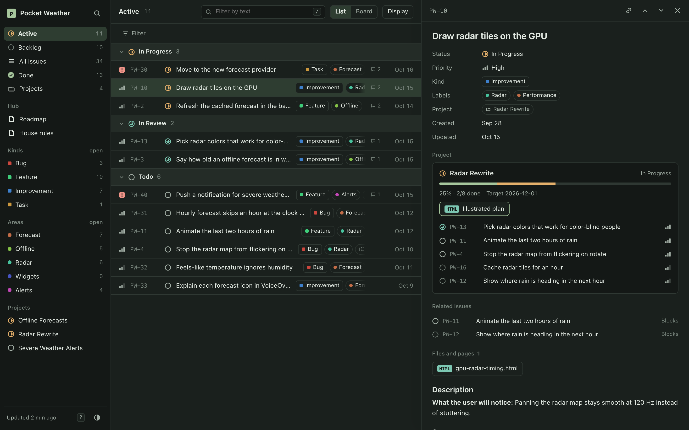
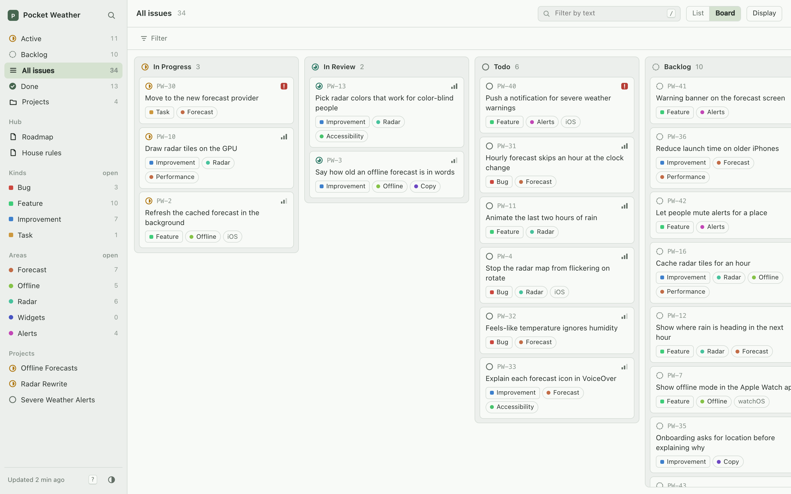
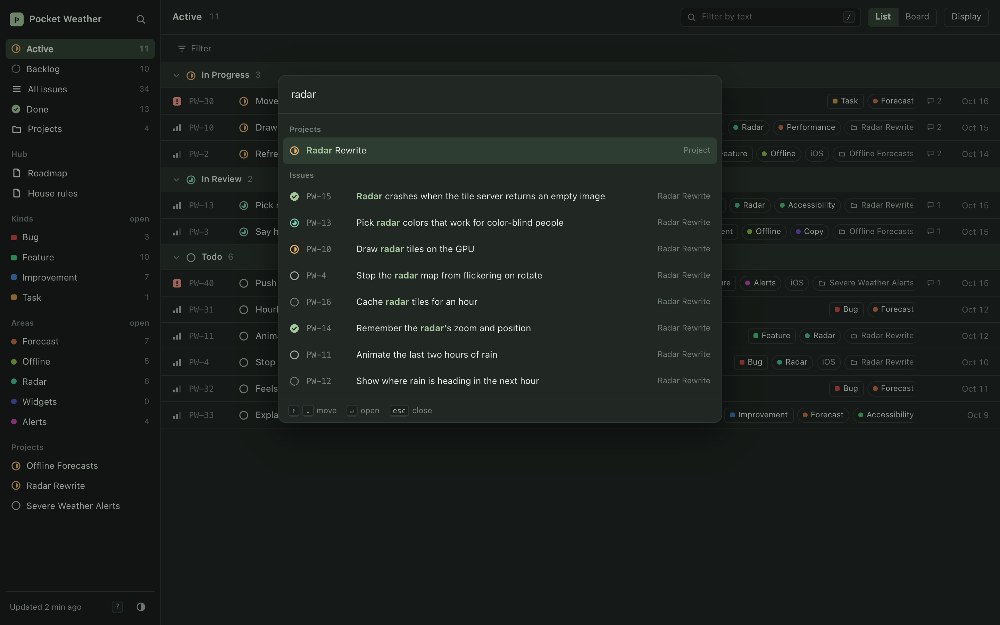
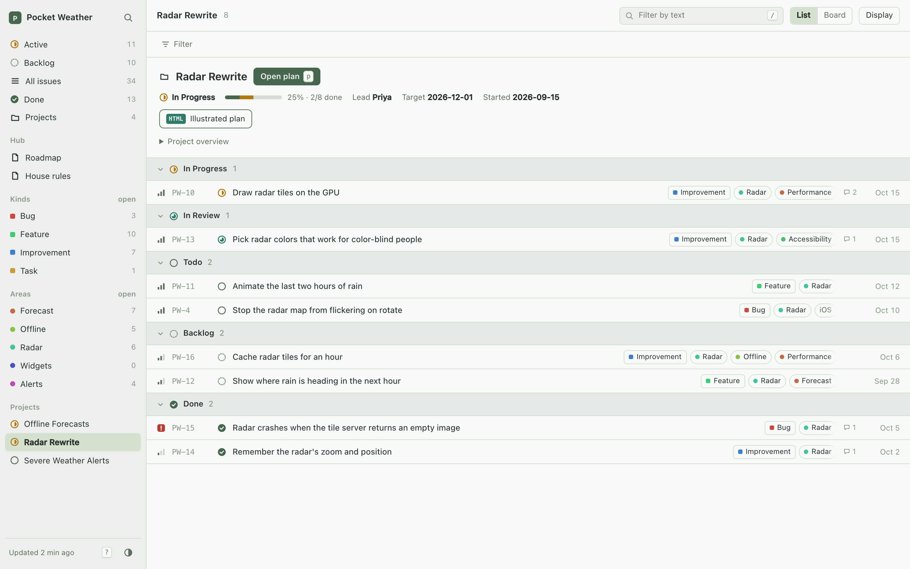
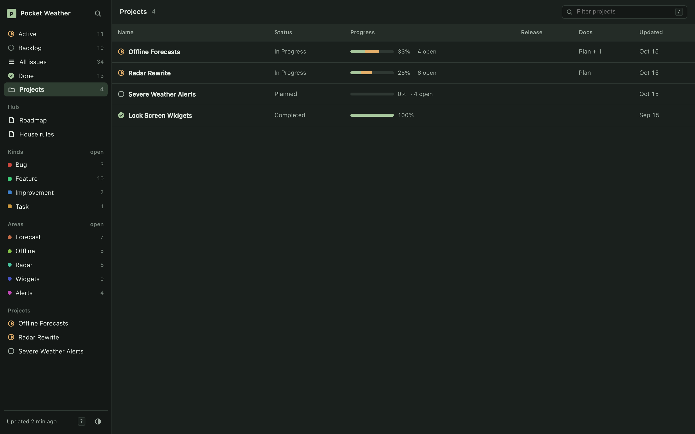

# issue-hub-board

A fast, Linear-style web app for issues kept as markdown files. Point it at a
folder of issues and get a list and a board, a command bar, keyboard
navigation, filters, and an issue panel that shows the project, its plan,
related issues and every file the issue links to. Read-only, so the files
stay the truth.

**[Try the live demo →](https://mueedqadri.github.io/issue-hub-board/)**
(a made-up weather app, Pocket Weather)



## Why it's different

**It runs on almost nothing.** The whole app is about 25 MB of RAM. On a
home server it serves a real hub of 962 issues in 23 MiB, with CPU near
zero. There's no database, no Node, no build step and no dependencies: just
Python's standard library and plain HTML, CSS and JavaScript. Self-hosted
trackers such as Plane ask for 4 GB or more. This fits next to everything
else on a Raspberry Pi, a NAS or the smallest VPS.

**It's made for working with coding agents.** Issues are markdown files in
git, the format agents already read and write. Pair it with
[issue-hub](https://github.com/mueedqadri/issue-hub), a skill for Claude
Code and other agents, and the agents run the tracker while you watch it
here:

- Parallel agent sessions reserve issue numbers that never collide, file
  issues from templates, move their status, and link commits to them.
- Agents save their plans, mockups and findings next to the issue, and the
  board shows each one in the issue's panel, opening in place.
- Each hub keeps its own house rules, kinds and labels, which agents follow
  and the board turns into filters and badges.
- The board is read-only, so it never fights an agent over a file. Changes
  show up the next time you look, or within two minutes on a server.

Without issue-hub it still works with any folder in
[the hub format](docs/format.md).

**It's quick.** Every issue is in memory, so search, filters and grouping
answer within a frame. The page draws from its last copy at once, then
checks for a newer one; an unchanged hub costs a `304`.

**Projects come with their documents.** An issue's panel shows its
project's progress, illustrated plan and documents, related issues in both
directions, and the issue's own pages and images. Point it at several hubs
and switch between them; `/` opens the one you used last.

**Your files stay the truth.** No import and no lock-in: the issues stay in
a git repo you already have, readable and editable by hand.

| | |
| --- | --- |
|  |  |
| Board columns by status | ⌘K jumps to any issue, project or command |
|  |  |
| A project's plan, opened in place | Projects with progress, newest first |

## Run it

With Python 3.10 or later:

```sh
uv tool install git+https://github.com/mueedqadri/issue-hub-board   # or pipx install …
issue-hub-board view ~/notes/my-hub
```

Or from a clone, with nothing installed:

```sh
git clone https://github.com/mueedqadri/issue-hub-board
cd issue-hub-board
./issue-hub-board view demo
```

It opens `http://127.0.0.1:8788`. Pass several hubs to switch between them:
`issue-hub-board view ~/notes/app-hub ~/notes/site-hub`.

| Command | What it does |
| --- | --- |
| `issue-hub-board view [HUB ...]` | Serve the viewer, re-exporting whenever a hub file changes. `--host`, `--port`, `--out`, `--no-open`. |
| `issue-hub-board export OUT [HUB ...]` | Write a static site. Add `--with-files` to copy each hub's files in too, for hosts like GitHub Pages. |
| `issue-hub-board edit [HUB]` | A simpler local kanban that can write: drag a card to change its status, or add a comment. Each write changes one line and refuses to overwrite a newer edit. |

Without `HUB`, it uses `$ISSUE_HUB`, else the nearest folder above you with
a `hub.json`, else the current folder.

## Keyboard

| Keys | |
| --- | --- |
| ⌘K | Search issues, projects and commands |
| `/` | Filter by text |
| `f` | Add a filter |
| `j` `k` | Move down and up |
| Enter | Open the issue |
| Esc | Close |
| `b` | Switch list and board |
| `g` then `a` `b` `l` `d` `p` | Active, Backlog, All, Done, Projects |
| `g` then `h` | Switch hub |
| `p` | Open the issue's project plan |
| `c` | Copy a link to the issue |
| `x` | Clear filters |

Every view, filter and open issue lives in the URL, so links can be shared.

## Host it

A container keeps a copy of each hub fresh from git and serves the viewer:

```sh
docker run -d --name issue-hub-board -p 127.0.0.1:8788:8788 \
  -e HUBS="https://github.com/you/your-hub.git" \
  -v "$PWD/data:/data" ghcr.io/mueedqadri/issue-hub-board:latest
```

| Variable | Default | Meaning |
| --- | --- | --- |
| `HUBS` | (required) | Git sources, one per hub, separated by spaces: URLs or paths inside the container |
| `BOARD_SOURCE` | the copy in the image | A git source for this repo, to pick up updates without pulling a new image |
| `BRANCH` | `main` | Branch to follow in every repo |
| `SYNC_INTERVAL` | `120` | Seconds between pulls |
| `HOST`, `PORT` | `0.0.0.0`, `8788` | Where the viewer listens inside the container |

[`deploy/docker-compose.example.yml`](deploy/docker-compose.example.yml) is
a ready compose file. For a private hub, either mount a git server's bare
repository read-only and list its path in `HUBS`, or use a read-only token in
the URL (`https://<user>:<token>@host/you/hub.git`) and keep the compose file
private.

**The viewer has no login** and shows everything in your hubs. Keep it on
localhost, a VPN or a tailnet. To give it its own Tailscale name, run a
`tailscale/tailscale` sidecar, put the board in its network
(`network_mode: service:<sidecar>`), set `HOST=127.0.0.1`, and point the
sidecar's serve config at `http://127.0.0.1:8788`.

For a static host instead, `issue-hub-board export site my-hub --with-files`
writes everything, hub files included, into `site/`. That is how
[the demo](https://mueedqadri.github.io/issue-hub-board/) is built.

## Develop

```sh
python3 tests/test_board.py
python3 tests/test_viewer.py
```

The viewer is `issue_hub_board/viewer/` (plain HTML, CSS and JavaScript,
no build step). `export.py` turns a hub into a slim card index plus one
pre-rendered page per issue, project and document; `view.py` serves it and
the hub's own files, never dotfiles or `.git`; `parse.py` and `render.py`
read the markdown. The demo hub in `demo/` is generated and made up.

## License

MIT
